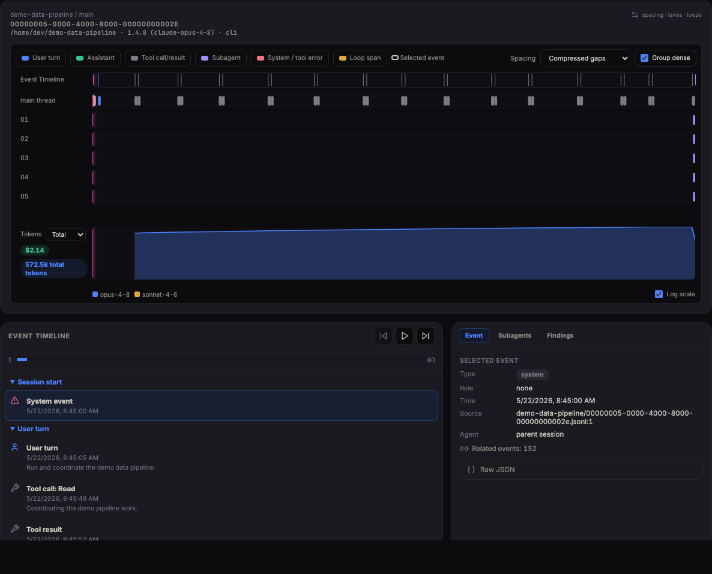
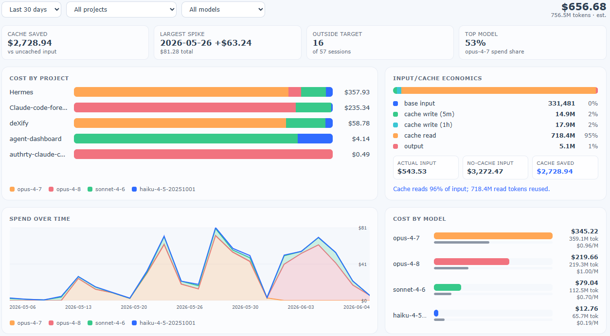
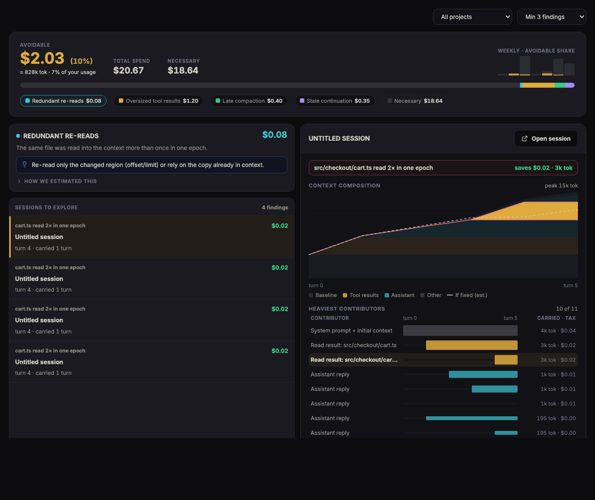

# Check Your Agent

[](https://pypi.org/project/checkyouragent/)
[](https://pypi.org/project/checkyouragent/)
[](https://github.com/TarekAwwad/checkyouragent/actions/workflows/ci.yml)
[](LICENSE)

[](https://checkyouragent.dev)

*[Visit checkyouragent.dev](https://checkyouragent.dev)*

Claude Code writes a detailed record of every session to `~/.claude/projects`.
Check Your Agent turns that record into estimated API-equivalent cost, observed
activity, and supported findings with evidence receipts. The app runs locally:
no accounts, no telemetry, no external calls, and the raw logs are never
modified. Tools like ccusage tell you *what* you used; Check Your Agent helps
you investigate *why* a session was expensive or unusual.

## Quick start

With `uv` (or `pipx`) installed:

```bash
uvx checkyouragent          # or: pipx run checkyouragent
```

This serves the app on `http://127.0.0.1:8000`, opens your browser, and uses
`~/.claude/projects` as the import root when it exists, otherwise `./Data`. No
exports handy? Add `--demo` to explore a bundled, fully synthetic dataset that
exercises every screen (the Import screen also offers **Load demo data** when
the cache is empty).

```bash
uvx checkyouragent --demo
uvx checkyouragent --import-root /path/to/exports
uvx checkyouragent --port 8123 --no-browser
```

The examples use `uvx`; replace `uvx` with `pipx run` if you prefer pipx. For a
persistent command, run `uv tool install checkyouragent` (or
`pipx install checkyouragent`). A persistent install also provides the shorter
`cya` alias, which behaves identically to `checkyouragent`.

In the app, open **Import** and choose **Sync new and updated**, use
**Sessions** to find sessions worth a closer look, open one to inspect its
timeline, trace, subagents, and supported findings, then use **Cost** and
**Explore** for the aggregate views.

## What it does

- **Import** synchronizes Claude Code project folders from a read-only export
  root into a rebuildable SQLite index. Re-importing a changed project rebuilds
  it from source.
- **Sessions** is an investigation board: supported findings, observed errors,
  subagent fanout, event volume, duration, and estimated cost, with search,
  filters, and sorting.
- The **session workspace** shows an event timeline with trace lanes, tool
  activity, a subagent heatmap, in-session search, supported findings with
  evidence receipts, and a raw event inspector.
- **Cost** breaks estimated API-equivalent cost down by project, model, and
  token category, with a cost-over-time chart, spike detection, turn
  distribution, and session outliers. Historical pricing is optional and
  date-aware.
- **Explore** covers limit hits, context economics, and usage drivers, plus an
  experimental section with the Usage Mindmap and subgroup discovery.
- **Team bundles** export allowlisted aggregates (no raw conversation content)
  that teammates can import for team Overview and Cost views. A privacy mode
  reduces visible sensitive text.

> [!NOTE]
> This is early-stage software. Costs are estimates computed from recorded
> tokens and bundled pricing tables, not invoice amounts, and the UI
> distinguishes values that are observed, estimated, inferred, or associated.
> Experimental views report classified activity and statistical associations,
> not causes. Privacy mode reduces visible sensitive text but is not data
> sanitization; review screenshots before sharing them.

<details>
<summary><strong>Product tour</strong>: explore the investigation and analytics screens</summary>

### Investigate one session

Follow the event timeline, compare trace lanes, inspect subagents, and open the
recorded evidence behind supported findings.

[](docs/screenshots/session-workspace.png)

### Understand cost

Break estimated API-equivalent cost down by project, model, token category, and
time, then drill into unusual sessions and turns.

[](docs/screenshots/cost-analytics-1.png)

### Explore context economics

Review estimated context opportunity, the assumptions behind it, and the
sessions and receipts that support each signal.

[](docs/screenshots/context-economics.png)

More screens - including import, subgroup discovery, and cost-outlier
drilldown - are in [`docs/screenshots/`](docs/screenshots).

</details>

## How it compares

Check Your Agent is not the only way to look at Claude Code usage.

| Tool | Best for | Trade-off vs Check Your Agent |
| --- | --- | --- |
| [ccusage](https://github.com/ccusage/ccusage) | Fast daily, monthly, and session usage/cost reports across coding-agent CLIs | Descriptive accounting rather than evidence-backed session investigation |
| [token-dashboard](https://github.com/nateherkai/token-dashboard) | Per-prompt cost analytics, tool/file heatmaps, cache analytics, and rule-based tips | Focuses on prompt-level hotspots and tips rather than supported findings with evidence receipts and context-carry attribution |
| [Sniffly](https://github.com/chiphuyen/sniffly) | Usage patterns, error breakdowns, message history, and optional sharing | Less focused on API-equivalent cost drivers and evidence-backed session investigation |
| [Anthropic native analytics](https://code.claude.com/docs/en/analytics) | Organization usage, spend, and adoption for Team/Enterprise and Console customers | Aggregate service-side reporting rather than local raw-session investigation |
| **Check Your Agent** | Deep local forensics: which sessions merit investigation, with observed activity, estimated cost, and receipts | Claude Code only; runs a local web app rather than printing a terminal report |

Reach for `ccusage` when you want a number in ten seconds; reach for Check Your
Agent when you want to know *why* the number is what it is and what to change.

## Other ways to run

### Docker

Prerequisite: Docker with Compose.

```bash
git clone https://github.com/TarekAwwad/checkyouragent
cd checkyouragent
docker compose up --build
```

Before starting, copy the project folders from `~/.claude/projects` into
`./Data`, or edit the `./Data:/imports:ro` Compose mount to point directly at
your Claude Code projects directory. The same commands work unchanged in
Windows PowerShell.

The frontend is at `http://localhost:5173` and backend API docs at
`http://localhost:8000/docs`, both bound to host loopback. Compose mounts the
configured import directory read-only, `./TeamBundles` for bundle exchange, and
the pricing files, and keeps the SQLite cache in a named `ccfr-data` volume, so
avoid `docker compose down -v` unless you mean to delete that cache.

### From source

Prerequisites: Python 3.11 or newer, `uv`, Node.js 20 or newer.

Run the backend and frontend in separate terminals, starting each one from the
repository root.

Backend:

```bash
cd backend
uv run uvicorn ccfr.main:app --reload --host 127.0.0.1 --port 8000
```

To run the backend tests, use `uv run --extra dev pytest` from `backend/`.

Frontend:

```bash
cd frontend
npm ci
npm run dev
```

Open `http://localhost:5174`. The dev server proxies `/api` to
`http://localhost:8000`, so leave `VITE_API_BASE` unset during development. To
serve the built UI from the Python package instead, build it first with
`python scripts/build_webui.py`.

## Configuration

Source-checkout defaults resolve from the repository root. Installed
(`uvx`/`pipx`) runs keep writable state under `~/.checkyouragent/` and read the
baseline price table bundled with the package.

| Variable | Source checkout | Installed run | Meaning |
| --- | --- | --- | --- |
| `CCFR_DATA_DIR` | `<repo>/.ccfr-data` | `~/.checkyouragent` | SQLite cache, settings, team bundles |
| `CCFR_DB_PATH` | `<repo>/.ccfr-data/ccfr.sqlite3` | `~/.checkyouragent/ccfr.sqlite3` | SQLite database file |
| `CCFR_IMPORT_ROOT` | `<repo>/Data` | `~/.claude/projects` when present, otherwise `./Data` | Root scanned for Claude Code project folders |
| `CCFR_TEAM_BUNDLE_ROOT` | `<repo>/.ccfr-data/team-bundles` | `~/.checkyouragent/team-bundles` | Team bundle export/import root |
| `CCFR_PRICING_PATH` | `<repo>/pricing.csv` | Bundled `pricing.csv` | Complete current price table |
| `CCFR_PRICING_DIR` | `<repo>/pricing` | `~/.checkyouragent/pricing` | Optional dated pricing snapshots |

The import root should look like Claude Code's `~/.claude/projects`: one folder
per project containing `<session-id>.jsonl` files, with optional per-session
subagent logs and tool results. The UI path field can select the configured
import root or a descendant; requests outside it are rejected. **Reset local
data** on the Import screen clears imported sessions while keeping settings and
imported team bundles.

`pricing.csv` holds the complete current price list in US dollars per million
tokens, and `pricing/` holds dated snapshots (`pricing-YYYY-MM-DD.csv`). Historical
mode applies snapshots through each event's date; current mode applies all of
them. Update the current CSV and add a new dated snapshot when rates change;
retain earlier snapshots. The current table and dated history both ship with
installed packages, which also read optional overrides from
`~/.checkyouragent/pricing` (or
`CCFR_PRICING_DIR`). Same-date local rows override bundled rows per model.
See [pricing history and sources](pricing/README.md).
Models without a price row are labeled as
partially priced rather than silently counted as zero.

The bundled pricing history was checked against [Anthropic's published pricing](https://platform.claude.com/docs/en/about-claude/pricing)
on 29 October 2026. It contains standard global API rates; fast mode, regional
premiums, and batch discounts are not applied.
The Haiku 5.5 row covers prompts up to 100,000 input tokens, including cache
reads and writes. Anthropic charges five times these rates for longer prompts;
the current flat table does not apply that tier, so those costs are underestimated.

The full configuration reference, data layout, and import behavior are in
[`docs/architecture.md`](docs/architecture.md).

## Limitations

- Ingestion is Claude Code `.claude/projects` JSONL only. It does not read
  Codex, OpenAI, or other agent histories.
- It is not a live integration. It reads the import root when you run an
  import, and it keeps no durable archive of sessions that disappear from the
  source export.
- Team views are aggregate-only by design. Bundles omit raw session detail, so
  team scope has no per-session drilldown.
- The backend is unauthenticated and intended for loopback use only. Do not
  expose it to a network; see [SECURITY.md](SECURITY.md).

## Documentation

- [Architecture](docs/architecture.md)
- [Privacy and data handling](PRIVACY.md)
- [Security](SECURITY.md)
- [Contributing](CONTRIBUTING.md)
- [Code of conduct](CODE_OF_CONDUCT.md)
- [Changelog](CHANGELOG.md)

## License

Check Your Agent is source-available under the
[Business Source License 1.1](LICENSE). It is free for personal and internal
use, including internal use inside a company. Offering it to third parties as a
hosted, managed, or embedded service requires a separate commercial license. On
the Change Date (2030-06-04) the code converts to Apache-2.0. The license text
in [`LICENSE`](LICENSE) governs.
